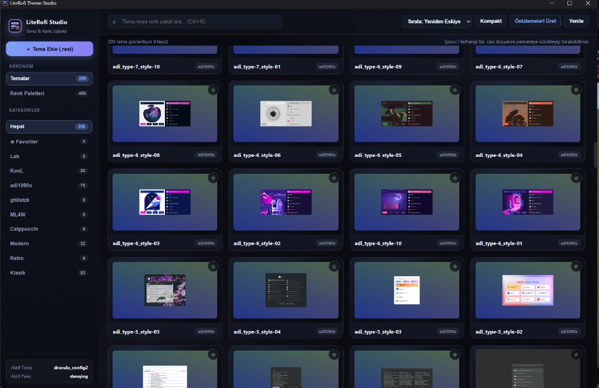
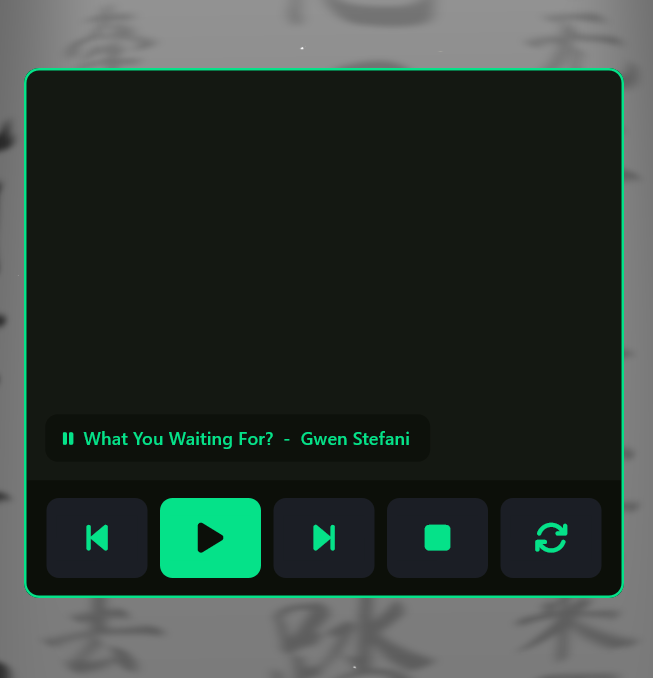
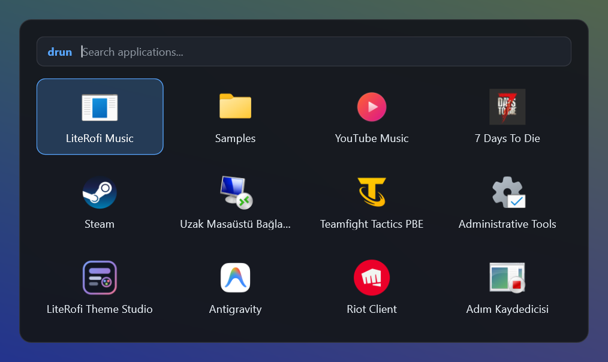

# LiteRofi — Rofi on Windows

A native **Windows 10/11** reimplementation of **[Rofi](https://github.com/davatorium/rofi)** written in pure **Rust** with Win32, Direct2D, DirectWrite, WIC, and Windows SMTC APIs.

LiteRofi brings full GitHub `.rasi` theme compatibility, frosted-glass desktop blur, an instant `Alt+Space` background daemon, a built-in **Music Widget**, and a standalone **LiteRofi Theme Studio** directly to Windows — with zero external runtime dependencies.

<p align="center">
  
</p>

## Screenshots

| LiteRofi Theme Studio (206 Themes + 406 Palettes) | Built-in Music Widget (Windows SMTC) |
| :---: | :---: |
|  |  |

| Launchpad Icon Grid (`-theme launchpad`) | Split Wallpaper Layout (`adi1090x`) |
| :---: | :---: |
|  |  |

## Features

- **Native Rofi `.rasi` Engine:** Supports `@import`, `@theme`, `var()`, `calc()`, `@media`, `linear-gradient(...)`, `background-image: url(...)`, Pango markup, Nerd Font PUA glyph fallback, vertical/horizontal/grid listviews, `icon-current-entry`, `textbox-current-entry`, frosted-glass desktop backdrop blur, and live hot-reload.
- **LiteRofi Theme Studio (`literofi-studio.exe`):** Standalone, zero-dependency visual gallery for browsing **200+ themes** and **400+ color palettes** with real Direct2D previews, category filters, sorting (`A→Z`, `Z→A`, `Newest`, `Oldest`), favorites, **drag-and-drop `.rasi` theme import**, and multi-language UI (**English** default + **Turkish**).
- **Built-in Music Widget (`-show music -theme music-player`):** Native Windows SMTC media controller (works with Spotify, YouTube Music, Chrome/Edge, VLC, etc.) showing live album artwork, track title, artist, and horizontal keyboard/mouse playback controls (`Prev`, `Play/Pause`, `Next`, `Stop`, `Refresh`).
- **Instant Global Hotkey (`Alt+Space`):** Lightweight `HWND_MESSAGE` background daemon (`~8 MB` idle RAM) that hot-reloads theme and color palette changes automatically.
- **Full Rofi Mode Parity:** `drun`, `run`, `window`, `windowcd`, `combi`, `dmenu`, `filebrowser`, `recursivebrowser`, `ssh`, `keys`, `theme`, `colors`, `music`, and custom `script` modes.

## Download & Install (Windows 10/11 x64)

1. **Windows Installer (Recommended):** Download `LiteRofi-0.1.0-win64-Setup.exe` from [GitHub Releases](https://github.com/merb2y/LiteRofi/releases).
   - Modern Windows Setup wizard (English & Turkish, no admin rights required).
   - Optional checkboxes for **LiteRofi Theme Studio**, **206 Themes + 406 Color Palettes**, **Start with Windows (`Alt+Space`)**, and **Desktop Shortcut**.
2. **Portable ZIP:** Download `LiteRofi-0.1.0-win64-portable.zip`, extract anywhere, and run `literofi.exe -show drun` or `literofi-studio.exe`.

> **Note:** Because releases are currently unsigned personal builds, Windows SmartScreen may show *"More info → Run anyway"*.

## Quick Usage

```powershell
# Launch application menu (Win32 AppsFolder + Start Menu shortcuts)
literofi -show drun

# Open the built-in Windows Music Widget (Spotify / YouTube Music / Chrome / VLC)
literofi -show music -theme music-player

# Open live interactive theme switcher / color palette switcher
literofi -show theme
literofi -show colors

# Use as a stdin filter (rofi -dmenu compatible)
"alpha`nbeta`ngamma" | literofi -dmenu -p "Select" -format "i:s"

# Start / stop the Alt+Space background daemon
literofi --start-daemon
literofi --stop-daemon

# Launch the visual Theme Studio gallery
literofi-studio
```

## Adding Custom GitHub `.rasi` Themes

- **Via Theme Studio:** Click **`+ Add Theme (.rasi)`** or drag-and-drop any `.rasi` file directly onto the Theme Studio window.
- **Manually:** Drop `.rasi` files into `%APPDATA%\LiteRofi\themes\` and set `@theme "your-theme"` inside `%APPDATA%\LiteRofi\config.rasi` (open with `literofi --settings`).

## Workspace Architecture

| Crate / Directory | Purpose |
| :--- | :--- |
| `crates/literofi-core` | CLI parser, `Config`, keybindings, 5 matchers (`normal`, `regex`, `glob`, `fuzzy`, `prefix`), scorers, `dmenu` protocol, and history |
| `crates/literofi-theme` | `.rasi` lexer/parser (`@import`/`@theme`, `var()`, `calc()`, `@media`, gradients, color spaces) and selector cascade |
| `crates/literofi-render` | `.rasi` layout tree + grid/scrollbar solver, Pango markup, Win32 Shell/WIC icon cache, Direct2D + DirectWrite renderer, desktop backdrop blur |
| `crates/literofi-modes` | All switcher modes (`drun`, `run`, `window`, `combi`, `dmenu`, `filebrowser`, `ssh`, `keys`, `theme`, `colors`, and Windows SMTC `music`) |
| `crates/literofi-cli` | `literofi.exe` (launcher + global hotkey daemon) and `literofi-studio.exe` (zero-dependency native Theme Studio) |
| `themes/` | Built-in themes including `music-player.rasi`, `launchpad.rasi`, and `tokyonight.rasi` |
| `studio/` | Theme Studio web UI (`index.html`, embedded into `literofi-studio.exe`) and multi-resolution `studio.ico` |
| `scripts/` | `package.ps1`, `literofi.iss` (Inno Setup 6), `install.ps1`, `uninstall.ps1`, and `audit-themes.ps1` |

## Building from Source

Requires Rust (`stable-x86_64-pc-windows-msvc`) and optionally [Inno Setup 6](https://jrsoftware.org/isinfo.php) to build the GUI installer:

```powershell
cargo test --workspace
cargo build --release --bins

# Package Portable ZIP + Windows GUI Setup.exe into dist\
powershell.exe -NoProfile -ExecutionPolicy Bypass -File .\scripts\package.ps1
```

## License

MIT — see [LICENSE](LICENSE).
