# LiteRofi — Rofi on Windows

A native **Windows 10/11** reimplementation of **[Rofi](https://github.com/davatorium/rofi)** written in pure **Rust** with Win32, Direct2D, DirectWrite, WIC, `eframe`/`egui`, WASAPI, and Windows SMTC APIs.

LiteRofi brings full `.rasi` theme compatibility, frosted-glass desktop backdrop blur, an instant `Alt+Space` background daemon, a suite of **15+ built-in native plugins**, **Wallpaper Engine (`ISteamUGC_v020`) & Wallhaven 4K** integration, and a pure-Rust GPU-accelerated **LiteRofi Theme Studio** directly to Windows — with zero external runtime dependencies.

<p align="center">
  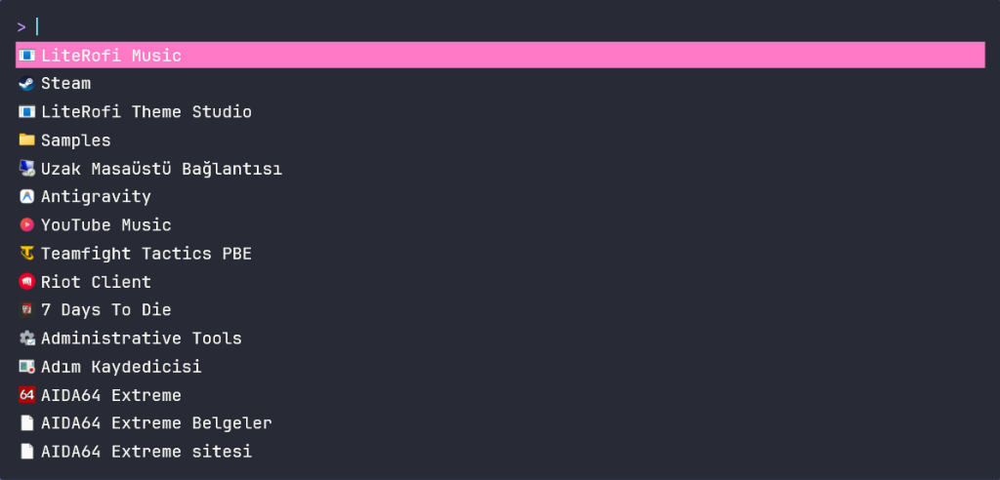
  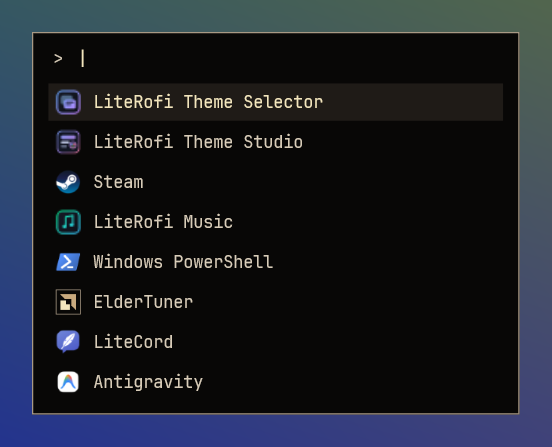
</p>

## Screenshots

### Core Launcher, System Menu & Theme Studio
| Mango-Minimal Launcher (`Alt+Space`) | Unified System Menu (`Ctrl+Alt+Space`) | LiteRofi Theme Studio (`literofi-studio.exe`) |
| :---: | :---: | :---: |
|  | 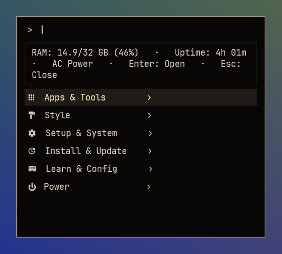 |  |

### Built-in Native Plugins & Carousels
| Game Launcher (`Alt+G`) | Slanted Wallpaper & WE Carousel (`Alt+W`) | Music Player Widget (`Alt+M`) |
| :---: | :---: | :---: |
| 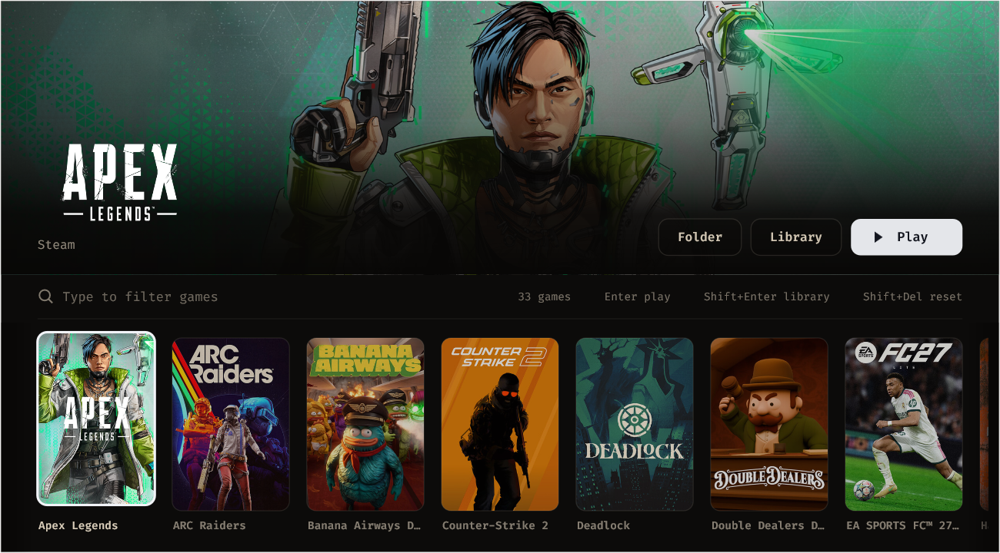 | 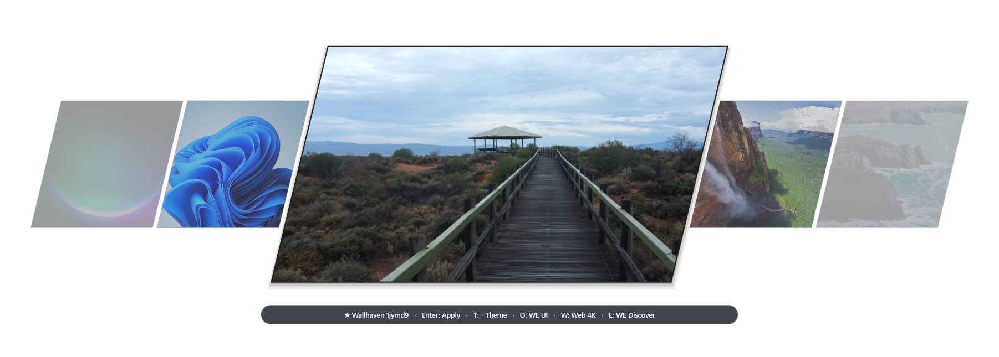 |  |

| Control Center (`Alt+D`) | Power Menu (`Alt+P`) | Clipboard History (`Alt+V`) |
| :---: | :---: | :---: |
| 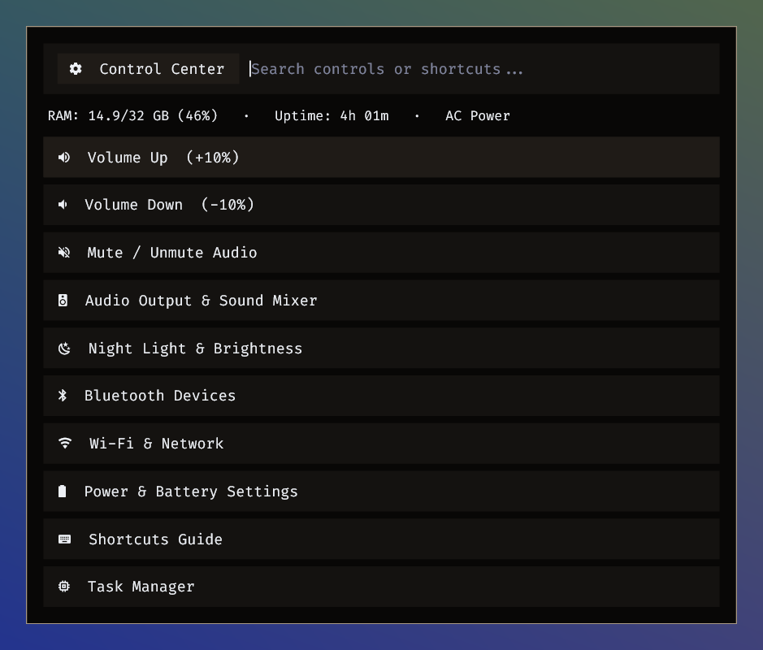 | 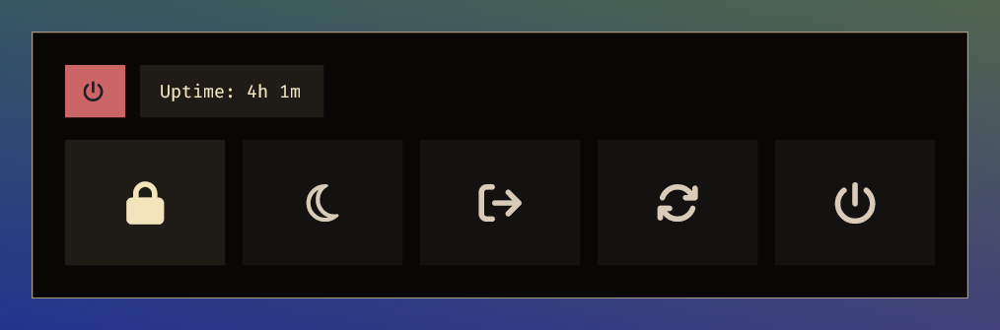 | 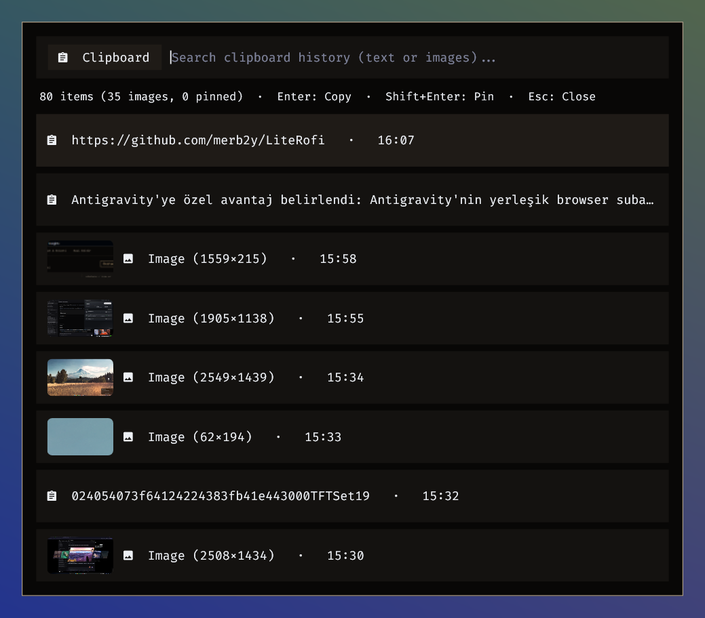 |

### Instant Utility Plugins & Community Layouts
| Calculator (`Alt+C`) | Emoji & Nerd Icons (`Alt+E`) | Web Bangs Search (`Alt+S`) | Snippets (`Alt+N`) |
| :---: | :---: | :---: | :---: |
| 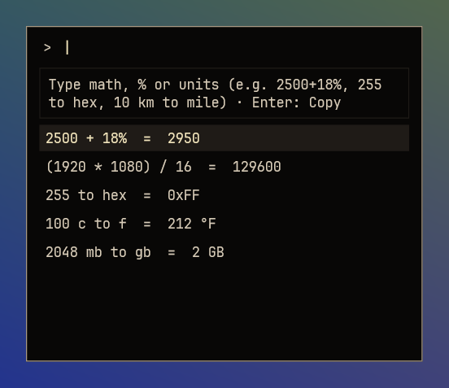 | 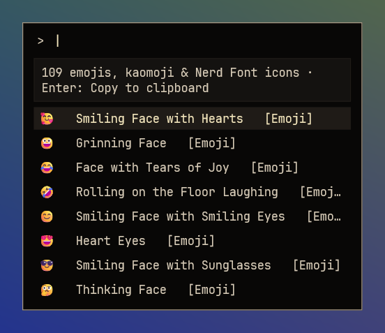 | 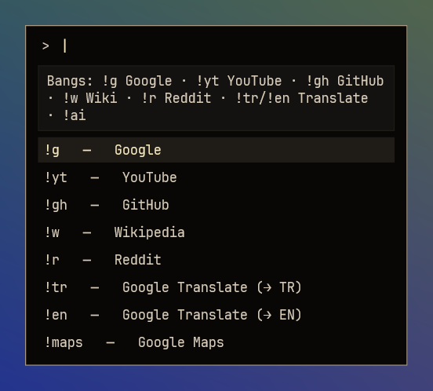 | 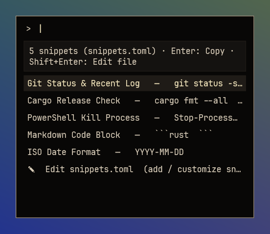 |

| Launchpad Icon Grid (`-theme launchpad`) | Split Wallpaper Layout (`adi1090x`) |
| :---: | :---: |
|  | 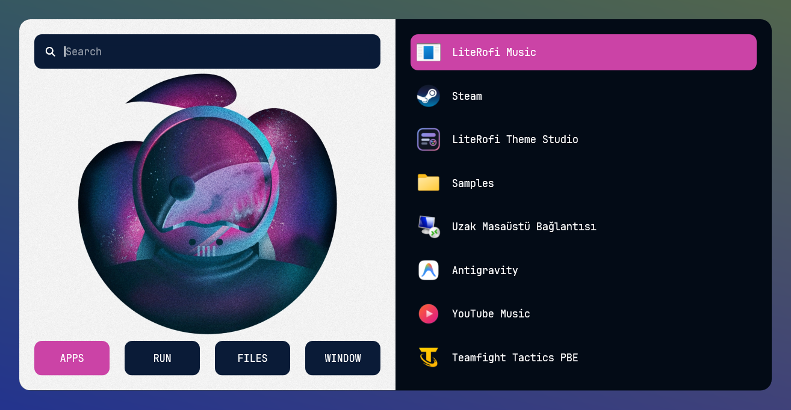 |

## Features

- **Native Rofi `.rasi` Engine:** Supports `@import`, `@theme`, `var()`, `calc()`, `@media`, `linear-gradient(...)`, `background-image: url(...)`, Pango markup, Nerd Font PUA glyph fallback, vertical/horizontal/grid listviews, `icon-current-entry`, `textbox-current-entry`, frosted-glass desktop backdrop blur, hover-to-select + single-click activation, and live hot-reload.
- **Pure-Rust Native Theme Studio (`literofi-studio.exe`):** Rebuilt cleanly with `eframe`/`egui` using a sharp `0px` Mango-Minimal UI:
  - **Switchable Navigation Layout:** Toggle between **Top Bar** and **Left Sidebar** (`Ayarlar` / top-bar quick switch), bilingual UI (**TR** / **EN**), and persistent density/sort preferences.
  - **200+ Themes & 400+ Palettes:** Non-blocking background `.rasi` scanning, visible-first async GPU thumbnail streaming, live launcher preview, favorites, drag-and-drop import, folder package import, and a built-in **Custom Palette Builder**.
  - **Visual Widget Customizer (`widgets.toml`):** Configure fonts (auto-detecting installed system & Nerd Fonts), colors, radii, **Wallhaven 4K** filters, and **Wallpaper Engine Workshop** filters without editing TOML by hand.
  - **Live `.rasi` Code Editor:** Built-in syntax validator (`ThemeSheet::parse_str`), extracted `#hex` color swatch inspector, and one-click re-render.
- **Wallpaper Engine (`ISteamUGC_v020`) + Wallhaven 4K (`Alt+W`):**
  - Default view unifies local wallpapers and subscribed Wallpaper Engine items on a slanted 3D-feel card carousel targeting whichever monitor your cursor is on (`IDesktopWallpaper` per-monitor support).
  - Press **`W`** for Wallhaven 4K discovery or **`E`** for native `steam_api64.dll` (`ISteamUGC_v020`) Steam Workshop discovery with progressive Frame-0 streaming + HD screenshot upgrades, **auto-subscribe & apply** on `Enter`, `O` to jump to the item inside Wallpaper Engine, `T` to sync active Wallust colors, and default-mute audio option.
- **Instant Global Hotkey Daemon:** Lightweight `HWND_MESSAGE` background service (`~8–15 MB` idle RAM) that hot-reloads theme/palette changes and hosts 12+ single-keystroke desktop modes.
- **Full Rofi Mode Parity + Windows Plugins:** `drun`, `run`, `window`, `windowcd`, `combi`, `dmenu`, `filebrowser`, `recursivebrowser`, `ssh`, `keys`, `theme`, `colors`, `menu`, `games`, `music`, `wallpaper`, `wallpaper-effects`, `clipboard`, `control`, `power`, `calc`, `emoji`, `search`, `snippets`, `translate`, `shortcuts`, and user `script` modes.

## Built-in Custom Plugins & Global Hotkeys

| Hotkey | Mode / Command | Description |
| :--- | :--- | :--- |
| **`Alt+Space`** | `literofi -show drun` | Instant Win32 + Start Menu app launcher (cached TSV index) |
| **`Ctrl+Alt+Space`** | `literofi -show menu` | Omarchy-style hierarchical system menu (Apps, Style, Setup, System, Power; empty `Backspace` navigates back) |
| **`Alt+W`** | `literofi -show wallpaper` | Slanted wallpaper carousel (`W`: Wallhaven 4K, `E`: Wallpaper Engine Workshop, `O`: Open in WE, `T`: Theme sync, `R`: Refresh) |
| **`Alt+G`** | `literofi -show games -theme game-launcher` | Visual cover-art carousel for installed Steam, Epic, GOG & Xbox games |
| **`Alt+M`** | `literofi -show music -theme music-player` | Native Windows SMTC media controller (Spotify, YouTube Music, Chrome, VLC) with album-art adaptive palette |
| **`Alt+V`** | `literofi -show clipboard -theme clipboard` | Text & image clipboard history manager with pin & instant paste |
| **`Alt+D`** | `literofi -show control -theme control-center` | Audio device/volume, display brightness, Night Light, Bluetooth, Wi-Fi & system toggles |
| **`Alt+P`** | `literofi -show power -theme powermenu` | Lock, Sleep, Logout, Reboot, and Shutdown tile menu |
| **`Alt+C`** | `literofi -show calc` | Instant math expression evaluator & unit/base converter (`255 to hex`, `100 c to f`, etc.) |
| **`Alt+E`** | `literofi -show emoji` | Searchable Emoji, Kaomoji & Nerd Font icon picker (`Enter` copies to clipboard) |
| **`Alt+S`** | `literofi -show search` | Fast Web Bangs (`!g`, `!yt`, `!gh`, `!w`, `!r`, `!tr`, `!ai`) & local file search |
| **`Alt+N`** | `literofi -show snippets` | Custom text & command snippet expander (`%APPDATA%\LiteRofi\snippets.toml`) |
| **`Alt+T`** | `literofi -show translate` | Instant inline text translator popup |

Extra modes runnable via CLI / System Menu (`-show <mode>`): `wallpaper-effects` (subtle vignette/tint filters), `shortcuts` (interactive keybind reference), `theme`, `colors`.

## Download & Install (Windows 10/11 x64)

1. **Windows Installer (Recommended):** Download `LiteRofi-0.2.0-win64-Setup.exe` from [GitHub Releases](https://github.com/merb2y/LiteRofi/releases).
   - Modern Windows Setup wizard (English & Turkish, no admin rights required).
   - Includes **LiteRofi Core + 15 Native Plugins**, **Pure-Rust Theme Studio**, **200+ Themes + 400+ Palettes**, custom `.ico` shortcuts, optional **Start with Windows (`Alt+Space`)**, and **Desktop Shortcut**.
2. **Portable ZIP:** Download `LiteRofi-0.2.0-win64-portable.zip`, extract anywhere, and run `literofi.exe --start-daemon` or `literofi-studio.exe`.

> **Note:** Because releases are currently unsigned personal builds, Windows SmartScreen may show *"More info → Run anyway"*.

## Quick CLI Usage

```powershell
# Start / stop the global hotkey background daemon
literofi --start-daemon
literofi --stop-daemon

# Launch specific plugins or themes directly
literofi -show drun -theme mango-minimal
literofi -show menu -theme mango-minimal
literofi -show wallpaper
literofi -show games -theme game-launcher
literofi -show music -theme music-player
literofi -show control -theme control-center
literofi -show clipboard -theme clipboard
literofi -show calc
literofi -show emoji

# Use as a stdin filter (rofi -dmenu compatible)
"alpha`nbeta`ngamma" | literofi -dmenu -p "Select" -format "i:s"

# Launch the pure-Rust Theme Studio
literofi-studio
```

## Custom Themes, Palettes & Scripts

- **Theme Studio (`literofi-studio`):** Add `.rasi` files or whole theme folders via **+ Add Theme**, drag-and-drop onto the window, build custom `.rasi` palettes, or edit `.rasi` code directly in the **Rasi Editor** tab.
- **Custom Plugins / Scripts:** Drop any `.ps1` or `.sh` script into `%APPDATA%\LiteRofi\scripts\` and launch it with `literofi -show <script-name>` (`rofi.exe` is automatically on `PATH` for `-dmenu` pipes).

## Workspace Architecture

| Crate / Directory | Purpose |
| :--- | :--- |
| `crates/literofi-core` | CLI parser, `Config`, `WidgetsConfig` (`widgets.toml`), 5 matchers (`normal`, `regex`, `glob`, `fuzzy`, `prefix`), scorers, `dmenu` protocol, history |
| `crates/literofi-theme` | `.rasi` lexer/parser (`@import`/`@theme`, `var()`, `calc()`, `@media`, gradients, color spaces) and selector cascade |
| `crates/literofi-render` | Layout tree + grid/scrollbar solver, Win32/WIC icon cache with CAS sharpening, Direct2D + DirectWrite renderer, desktop blur, slanted wallpaper carousel, game launcher & SMTC music UI |
| `crates/literofi-modes` | Switcher modes & plugins (`drun`, `run`, `window`, `combi`, `dmenu`, `menu`, `games`, `music`, `wallpaper` + Steam UGC IPC, `clipboard`, `control`, `power`, `calc`, `emoji`, `search`, `snippets`, `translate`, `wallpaper_effects`, `shortcuts`, `theme`, `colors`, `script`) |
| `crates/literofi-cli` | `literofi.exe` launcher, per-monitor DPI placement, and global hotkey background daemon |
| `crates/literofi-studio` | Standalone pure-Rust GPU-accelerated Theme Studio (`literofi-studio.exe`) built with `eframe`/`egui` |
| `themes/` | Built-in themes including `mango-minimal.rasi`, `mango-minimal-wallust.rasi`, `music-player.rasi`, `game-launcher.rasi`, `control-center.rasi`, `clipboard.rasi`, `powermenu.rasi`, `wallpaper-picker.rasi`, `launchpad.rasi`, `tokyonight.rasi`, and `ntcarlson/` |
| `studio/` | Multi-resolution `studio.ico`, custom shortcut `icons/*.ico` suite, and original web reference (`index.html`, `server.py`) |
| `rust/` | `rust-anything` port architecture docs (`DECISIONS.md`, `MAP.md`, `GLOSSARY.md`) |
| `scripts/` | `package.ps1`, `literofi.iss` (Inno Setup 6), `install.ps1`, `uninstall.ps1`, and `audit-themes.ps1` |

## Building from Source

Requires Rust (`stable-x86_64-pc-windows-msvc`) and optionally [Inno Setup 6](https://jrsoftware.org/isinfo.php) to build the GUI installer:

```powershell
cargo test --workspace
cargo build --release --bins

# Package Portable ZIP + Windows GUI Setup.exe into dist\
powershell.exe -NoProfile -ExecutionPolicy Bypass -File .\scripts\package.ps1
```

## Credits & Acknowledgments

LiteRofi is an independent, from-scratch Windows + Rust reimplementation inspired by and designed for compatibility with **[Rofi](https://github.com/davatorium/rofi)** by **Dave Davenport (`davatorium`) and contributors** (MIT License). All `.rasi` theme language syntax, widget hierarchy, CLI flags, and mode concepts originate from upstream Rofi.

Bundled community themes, color palettes, and widget inspirations belong to their respective open-source authors:
- **[davatorium/rofi](https://github.com/davatorium/rofi)** & **[davatorium/rofi-themes](https://github.com/davatorium/rofi-themes)** — Official Rofi project & classic themes
- **[dracula/rofi](https://github.com/dracula/rofi)** — Default `dracula_config2` theme
- **[adi1090x/rofi](https://github.com/adi1090x/rofi)**, **[newmanls/rofi-themes-collection](https://github.com/newmanls/rofi-themes-collection)**, **[catppuccin/rofi](https://github.com/catppuccin/rofi)**, **[gh0stzk/dotfiles](https://github.com/gh0stzk/dotfiles)**, **[mylinuxforwork/dotfiles](https://github.com/mylinuxforwork/dotfiles)** — Community `.rasi` themes
- **[tinted-theming/base16-rofi](https://github.com/tinted-theming/base16-rofi)** — Base16 color palettes
- **[niraj998/Rofi-Scripts](https://github.com/niraj998/Rofi-Scripts)** — Visual inspiration for the built-in `music-player.rasi` layout

## License

MIT — see [LICENSE](LICENSE).
